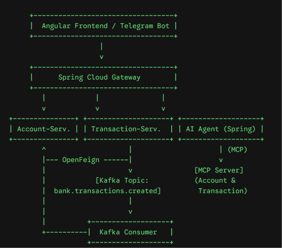
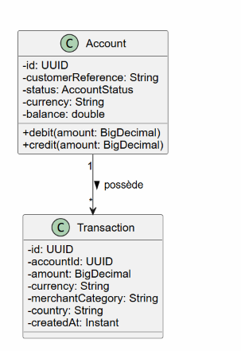

# 🏦 Plateforme Bancaire Micro-services & IA (Adria PFE)

Plateforme micro-services résiliente permettant de consulter les comptes bancaires, d'enregistrer des transactions, de publier des événements métier via **Kafka**, d'interagir via un **Assistant Conversationnel AI (Spring AI & MCP)** et d'exploiter un module de détection de fraude en Python.

---

##  1. Schéma d'Architecture Cible

> *Vue d'ensemble de l'architecture technique du système (Gateway, Services, Communication synchrone/asynchrone et Agent IA).*

##  2. Diagramme de classes (Domaine Métier)

Le diagramme ci-dessous modélise les entités principales de l'application (`Account` et `Transaction`) ainsi que leur relation[cite: 2] :

!

           